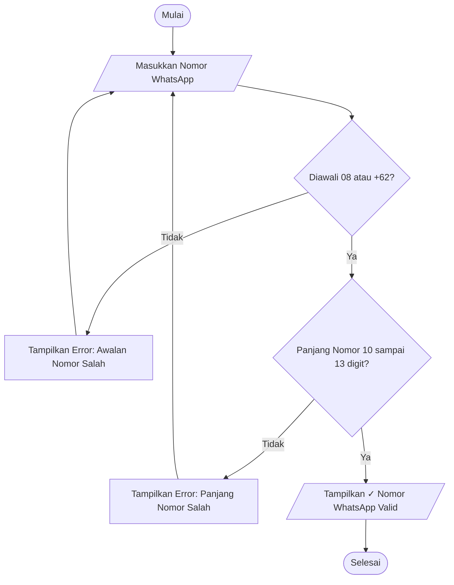

# Tugas Mandiri 02c — Flowchart Validasi Nomor WhatsApp

**Nama:** Ahmad Maulana  
**Topik:** Validasi Nomor WhatsApp Indonesia

## 1. Tujuan

Membuat alur logika untuk memeriksa nomor WhatsApp yang dimasukkan pengguna. Nomor dinyatakan valid jika diawali dengan `08` atau `+62` dan memiliki panjang antara 10 sampai 13 digit.

## 2. Aturan Validasi

1. Pengguna memasukkan nomor HP.
2. Nomor harus diawali dengan `08` atau `+62`.
3. Panjang nomor harus antara 10 sampai 13 digit.
4. Jika tidak memenuhi syarat, sistem menampilkan pesan error dan meminta pengguna memasukkan nomor kembali.
5. Jika memenuhi semua syarat, sistem menampilkan tanda centang sukses.

## 3. Flowchart Mermaid

## 4. Contoh Pengujian

| Nomor WhatsApp | Hasil |
|---|---|
| 081234567890 | Valid |
| +6281234567890 | Valid |
| 071234567890 | Tidak Valid |
| 0812345 | Tidak Valid |
| 0812345678901234 | Tidak Valid |

## 5. Kesimpulan

Dari flowchart ini, saya belajar bahwa validasi nomor WhatsApp membutuhkan beberapa langkah pemeriksaan. Nomor harus memiliki awalan yang benar dan panjang yang sesuai. Jika salah satu syarat tidak terpenuhi, pengguna harus memasukkan nomor kembali sampai benar.