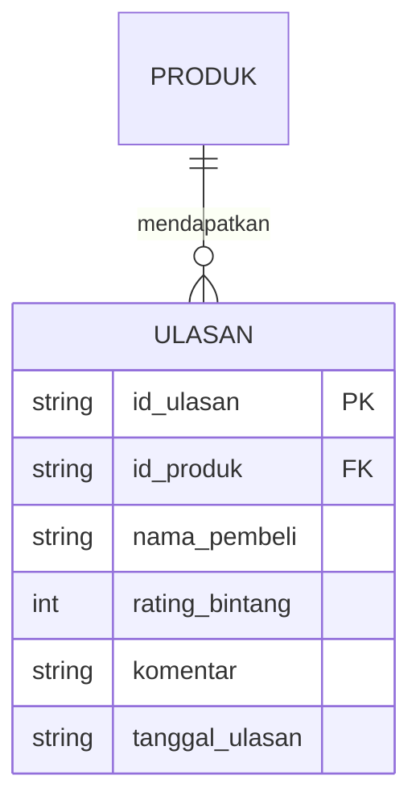

# Tugas Mandiri 02d — Model Data Fitur Ulasan Produk

**Nama:** Ahmad Maulana  
**Topik:** Model Data Fitur Ulasan Produk

## 1. Tujuan

Membuat entitas baru bernama ULASAN untuk menambahkan fitur penilaian produk pada halaman katalog UMKM. Pembeli dapat memberikan rating bintang 1 sampai 5 dan menuliskan komentar setelah membeli produk.

## 2. Struktur Entitas Baru: ULASAN

## 3. Daftar Atribut dan Tipe Data

| No | Nama Atribut | Tipe Data | Keterangan |
|---|---|---|---|
| 1 | id_ulasan | string | Primary Key (PK) |
| 2 | id_produk | string | Foreign Key (FK) |
| 3 | nama_pembeli | string | Nama orang yang memberikan ulasan |
| 4 | rating_bintang | int | Nilai bintang 1–5 |
| 5 | komentar | string | Isi komentar pembeli |
| 6 | tanggal_ulasan | string | Tanggal ulasan dibuat |

## 4. Penjelasan Relasi dan Kunci

**A. Relasi**

Relasi antara entitas PRODUK dan ULASAN adalah **One to Many (1:N)** atau satu ke banyak.

Artinya:
- Satu produk bisa mendapatkan banyak ulasan dari pembeli yang berbeda.
- Satu produk juga boleh belum memiliki ulasan.
- Satu ulasan hanya ditujukan untuk satu produk tertentu.

**B. Primary Key (PK)**

`id_ulasan` merupakan Primary Key yang digunakan sebagai identitas unik untuk setiap ulasan agar tidak tertukar dengan ulasan lainnya.

**C. Foreign Key (FK)**

`id_produk` merupakan Foreign Key yang menghubungkan entitas ULASAN dengan entitas PRODUK. Atribut ini mengambil referensi dari `id_produk` yang menjadi Primary Key pada tabel PRODUK.

## 5. Contoh Data Ulasan

| id_ulasan | id_produk | nama_pembeli | rating_bintang | komentar |
|---|---|---|---|---|
| U001 | P001 | Andi | 5 | Rasanya enak dan harganya terjangkau. |
| U002 | P001 | Budi | 4 | Produk bagus dan sesuai harga. |
| U003 | P002 | Siti | 5 | Sangat suka dengan produknya. |

## 6. Kesimpulan

Dari tugas ini, saya belajar bahwa entitas ULASAN digunakan untuk menyimpan penilaian dan komentar pembeli terhadap produk. Relasi PRODUK dan ULASAN adalah satu ke banyak (1:N), karena satu produk dapat memiliki banyak ulasan. Dengan adanya Primary Key dan Foreign Key, data ulasan dapat terhubung dengan produk yang tepat.