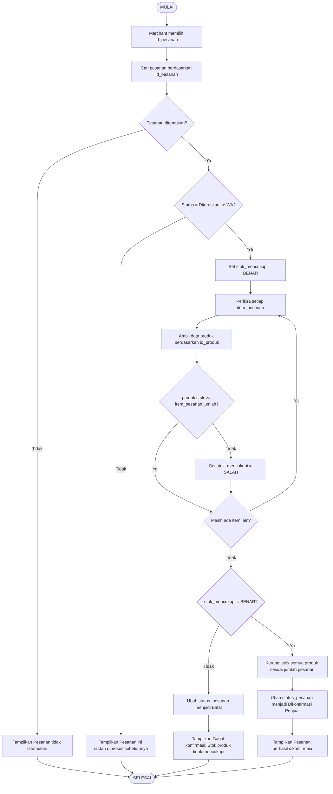
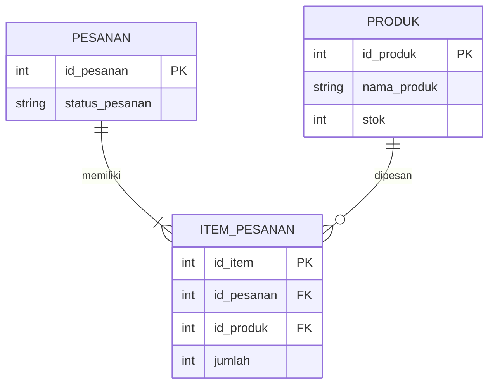

# Kelompok Aing Maung 
# BLUEPRINT FITUR TERPADU
## Fitur Konfirmasi Pesanan WhatsApp oleh Merchant & Potong Stok Otomatis (Opsi A)

### 1. Nama Fitur Pilihan

**Opsi A: Konfirmasi Pesanan WhatsApp oleh Merchant & Potong Stok Otomatis**

**Tujuan:**

Membuat sistem yang membantu merchant mengonfirmasi pesanan pelanggan melalui dashboard. Stok produk hanya akan dikurangi jika pesanan sudah dikonfirmasi oleh merchant dan seluruh stok produk mencukupi.

---

### 2. Dekomposisi Masalah (6 Langkah)

Berikut langkah-langkah untuk memecahkan masalah menjadi bagian yang lebih kecil:

1. **Memilih Pesanan:** Merchant membuka dashboard dan memilih `id_pesanan` yang ingin dikonfirmasi.
2. **Mencari Pesanan:** Sistem mencari data pesanan berdasarkan `id_pesanan`. Jika tidak ditemukan, sistem menampilkan pesan bahwa pesanan tidak ditemukan.
3. **Memeriksa Status:** Sistem memeriksa apakah `status_pesanan` masih bernilai "Diteruskan ke WA". Jika status berbeda, konfirmasi ditolak.
4. **Memeriksa Stok Produk:** Sistem memeriksa setiap produk berdasarkan `id_produk` dan membandingkan `produk.stok` dengan `item_pesanan.jumlah`.
5. **Memproses Konfirmasi:** Jika ada stok yang tidak mencukupi, status pesanan diubah menjadi "Batal". Jika semua stok mencukupi, sistem mengurangi stok setiap produk sesuai jumlah pesanan.
6. **Mengubah Status dan Memberikan Pesan:** Jika berhasil, sistem mengubah `status_pesanan` menjadi "Dikonfirmasi Penjual" dan menampilkan pesan sukses.

---

### 3. Pseudocode Lengkap

```text
MULAI

INPUT id_pesanan

CARI pesanan berdasarkan id_pesanan

JIKA pesanan tidak ditemukan MAKA
    TAMPILKAN "Pesanan tidak ditemukan"

LAINNYA

    JIKA status_pesanan = "Diteruskan ke WA" MAKA

        SET stok_mencukupi = BENAR

        UNTUK setiap item_pesanan

            CARI produk berdasarkan id_produk

            JIKA produk.stok < item_pesanan.jumlah MAKA
                SET stok_mencukupi = SALAH
            AKHIR-JIKA

        AKHIR-UNTUK

        JIKA stok_mencukupi = SALAH MAKA

            SET status_pesanan = "Batal"

            TAMPILKAN "Gagal konfirmasi: Stok produk tidak mencukupi"

        LAINNYA

            UNTUK setiap item_pesanan

                KURANGI produk.stok
                SEBANYAK item_pesanan.jumlah

            AKHIR-UNTUK

            SET status_pesanan = "Dikonfirmasi Penjual"

            TAMPILKAN "Pesanan berhasil dikonfirmasi"

        AKHIR-JIKA

    LAINNYA

        TAMPILKAN "Pesanan ini sudah diproses sebelumnya"

    AKHIR-JIKA

AKHIR-JIKA

SELESAI
```

Penjelasan Pseudocode
- MULAI
Sistem mulai menjalankan proses konfirmasi pesanan.
- INPUT id_pesanan
Merchant memasukkan nomor pesanan yang ingin dikonfirmasi.
- CARI pesanan berdasarkan id_pesanan
Sistem mencari pesanan di dalam database.
- PERIKSA PESANAN
Jika pesanan tidak ditemukan, tampilkan pesan "Pesanan tidak ditemukan". Jika ditemukan, lanjutkan proses.
- PERIKSA STATUS PESANAN
Jika status masih "Diteruskan ke WA", pesanan boleh diproses. Jika sudah diproses, tampilkan pesan bahwa pesanan sudah diproses sebelumnya.
- SET stok_mencukupi = BENAR
Sistem menganggap stok mencukupi sebelum melakukan pemeriksaan.
- PERIKSA SETIAP ITEM PESANAN
Sistem memeriksa semua produk yang dipesan satu per satu.
- CARI PRODUK
Sistem mencari data produk berdasarkan id_produk.
- PERIKSA STOK
Sistem membandingkan stok tersedia dengan jumlah pesanan. Jika stok kurang, ubah stok_mencukupi menjadi SALAH.
- PERIKSA HASIL STOK
Jika ada stok yang kurang, pesanan dibatalkan dan sistem menampilkan pesan kegagalan.
- KURANGI STOK
Jika semua stok mencukupi, sistem mengurangi stok sesuai jumlah pesanan.
- UBAH STATUS PESANAN
Sistem mengubah status menjadi "Dikonfirmasi Penjual".
- TAMPILKAN PESAN BERHASIL
Sistem menampilkan pesan "Pesanan berhasil dikonfirmasi".
- SELESAI
Proses konfirmasi pesanan selesai.

Kesimpulan cara kerja pseudocode
1. Merchant memasukkan ID pesanan.
2. Sistem mencari pesanan tersebut.
3. Sistem memeriksa status pesanan.
4. Sistem memeriksa ketersediaan semua stok produk.
5. Jika stok tidak cukup, pesanan dibatalkan.
6. Jika stok cukup, stok dikurangi sesuai jumlah pesanan.
7. Status berubah menjadi Dikonfirmasi Penjual dan proses selesai.
---

### 4. Flowchart Sistem (Mermaid)

Flowchart menggambarkan alur proses konfirmasi pesanan dari merchant memilih pesanan sampai sistem memberikan hasil.



---

### 5. Potongan ERD (Mermaid)

ERD berikut menampilkan tiga entitas yang digunakan dalam fitur, yaitu PESANAN, ITEM_PESANAN, dan PRODUK.



**Keterangan entitas:**

1. **PESANAN:** Menyimpan identitas dan status pesanan pelanggan.
2. **ITEM_PESANAN:** Menyimpan daftar produk dan jumlah produk yang dipesan.
3. **PRODUK:** Menyimpan data produk termasuk jumlah stok yang tersedia.

**Relasi:**
- Satu pesanan memiliki satu atau lebih item pesanan.
- Satu produk dapat muncul dalam banyak item pesanan.
- Setiap item pesanan terhubung dengan satu pesanan dan satu produk.

---

### 6. Tabel Audit Konsistensi

Tabel ini digunakan untuk memeriksa apakah pseudocode, flowchart, dan ERD sudah saling sesuai.

| No. | Variabel / Kondisi | Pseudocode | Flowchart | ERD | Status |
|---|---|---|---|---|---|
| 1 | `id_pesanan` | Input dan pencarian pesanan | Proses pencarian pesanan | `PESANAN.id_pesanan` | Sesuai |
| 2 | `status_pesanan` | Memeriksa dan mengubah status | Belah ketupat pemeriksaan status | `PESANAN.status_pesanan` | Sesuai |
| 3 | `id_produk` | Mencari produk | Proses mengambil data produk | `ITEM_PESANAN.id_produk` dan `PRODUK.id_produk` | Sesuai |
| 4 | `item_pesanan.jumlah` | Membandingkan dan mengurangi stok | Proses pemeriksaan dan pengurangan stok | `ITEM_PESANAN.jumlah` | Sesuai |
| 5 | `produk.stok` | Memeriksa dan mengurangi stok | Belah ketupat pemeriksaan stok dan proses pengurangan | `PRODUK.stok` | Sesuai |
| 6 | `stok_mencukupi` | Menentukan hasil pemeriksaan semua stok | Belah ketupat hasil pemeriksaan stok | Variabel sementara, tidak perlu menjadi kolom ERD | Sesuai |

---

### 7. Hasil Audit Konsistensi

Berdasarkan pemeriksaan antara pseudocode, flowchart, dan ERD:

1. Setiap kondisi `JIKA` sudah memiliki percabangan keputusan berbentuk belah ketupat pada flowchart.
2. Setiap variabel data yang diperiksa atau diubah sudah memiliki atribut yang sesuai pada ERD.
3. Nama atribut yang digunakan sudah konsisten, seperti `id_pesanan`, `status_pesanan`, `id_produk`, `jumlah`, dan `stok`.
4. Variabel sementara `stok_mencukupi` tidak perlu disimpan dalam ERD karena hanya digunakan selama proses pemeriksaan.
5. Pengurangan stok hanya dilakukan setelah semua produk dinyatakan mencukupi.

**Kesimpulan:**

Blueprint fitur Opsi A sudah menghubungkan dekomposisi, pseudocode, flowchart, dan ERD dalam satu alur yang saling berhubungan. Sistem dapat mencegah pengurangan stok sebelum pesanan dikonfirmasi serta mencegah stok menjadi minus.